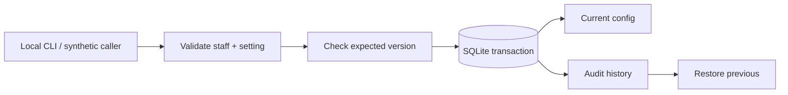

# Config Manager — Versioned Python Backend Demo

**Safe local settings changes · SQLite transactions · optimistic concurrency · audit history**

[](https://github.com/Scumbagsss/discord-config-manager/actions/workflows/config-demo.yml)


> **Public runnable demo + private-source case study.** The new `config_demo.py` is an independent synthetic example using **only the Python standard library**. The commercial Discord configuration manager and its production configuration remain private; [`src/public_interface.py`](src/public_interface.py) is an intentionally unimplemented architectural sketch.

## Why this matters

Administrative config edits may be small individually, but changes must be **validated, authorized, consistent and traceable**. Two simultaneous reviewers must not silently overwrite one another. Invalid updates must not leave half-written settings.

The demo models a small backend service with an explicit list of five **fictional, non-secret settings**.

## Try it locally

Requires Python **3.11+**, no Discord token, third-party dependencies or external services.

```bash
python config_demo.py --db demo-config.sqlite3 list
python config_demo.py --db demo-config.sqlite3 get support.max_open_tickets
python config_demo.py --db demo-config.sqlite3 set support.max_open_tickets 15 --version 1
python config_demo.py --db demo-config.sqlite3 history support.max_open_tickets
python config_demo.py --db demo-config.sqlite3 restore support.max_open_tickets --version 2
python -m unittest discover -s tests -v
```

## Backend concepts demonstrated

| Capability | Implementation |
|---|---|
| Validation | Whitelist of keys and strict type/range checks |
| Persistence | File-backed SQLite with parameterized SQL |
| Conflict prevention | Expected-version checks inside `BEGIN IMMEDIATE` |
| Multiple updates | One transaction; all changes commit or none do |
| Auditability | Records actor, key, old/new values, version and timestamp |
| Recovery | Restore a previous value while retaining history |
| Reliability | Idempotent no-op updates and fresh-instance persistence |
| Tests | **36 synthetic unit tests**, Python 3.11–3.13 GitHub Actions matrix |



**The caller-provided `Actor(staff=True)` is not user authentication**. This is a local exercise rather than a publicly deployable admin service. No secrets or production bot settings are accepted.

Read the [engineering walkthrough](docs/CONFIG_DEMO.md) for version conflicts, safe rollback, batch semantics and limitations.

## Private commercial context

The private Discord configuration module is described as a staff interface for JSON/JSONC editing, backups and runtime configuration management. The public demo uses **SQLite instead of the proprietary production adapters**, and does not connect to Discord or change live JSON/JSONC files.

- [`config_demo.py`](config_demo.py) — independent runnable Python backend / CLI
- [`tests/test_config_demo.py`](tests/test_config_demo.py) — fictional tests
- [`.github/workflows/config-demo.yml`](.github/workflows/config-demo.yml) — continuous validation
- [`docs/ARCHITECTURE.md`](docs/ARCHITECTURE.md) — conceptual private-source design
- [`src/public_interface.py`](src/public_interface.py) — **non-runnable**, private-system signature sketch
- [`NOTICE.md`](NOTICE.md) — publication boundary

**Contact:** Discord `scumbagsss` · Telegram [@dilarion](https://t.me/dilarion)
