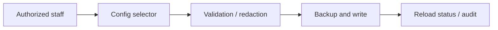

# Discord Config Manager

**Controlled JSON/JSONC changes through a Discord interaction layer**

  

> **Documentation-only portfolio case study.** The source under [`src/public_interface.py`](src/public_interface.py) is intentionally unimplemented and raises `NotImplementedError`. This is **not** a runnable bot, a deployment package or independently verified production evidence.

## Why this module exists

Operational settings that live in JSON/JSONC files are easy to change incorrectly. A staff interface can offer validated edits, backup-before-write behavior and clear permission boundaries without disclosing raw configuration to all moderators.

**Technology context:** Python, discord.py, JSON/JSONC, file operations. These technologies describe the private module's documented domain; public executable implementation is not provided.

## Workflow at a glance

1. Choose an authorized configuration source and setting
2. Validate the staff identity and restrict sensitive fields
3. Parse and validate the proposed value against its schema
4. Create a recoverable backup before applying the change
5. Write safely and report whether a restart or refresh is necessary

These stages summarize the public project description; the exact runtime and private integration details cannot be independently verified from the public skeleton.

## Engineering challenges

| Topic | Why it matters | How it should be verified |
|---|---|---|
| Secret leakage | Config files may include tokens or webhooks | Redact values and deny sensitive paths |
| Concurrent edits | Two staff changes can overwrite each other | Use version checks or atomic read-modify-write |
| Corrupt writes | Partial changes can make a bot fail at startup | Use backup and atomic replacement |
| Runtime drift | A saved value may not be loaded into a running service | Report restart/reload state explicitly |

## Component boundary

This diagram is **conceptual**, not a snapshot of private production architecture. See the [design notes](docs/ARCHITECTURE.md) for boundaries, failure scenarios and test ideas.

## Repository contents and status

- [`src/public_interface.py`](src/public_interface.py) — non-runnable, documented public interface skeleton
- [`docs/ARCHITECTURE.md`](docs/ARCHITECTURE.md) — engineering design notes (no operational secrets)
- [`examples/config.example.jsonc`](examples/config.example.jsonc) — illustrative configuration shape, **not** a production configuration
- [`NOTICE.md`](NOTICE.md) and [`SECURITY.md`](SECURITY.md) — publication/security boundary

**Portfolio role:** Private-source configuration-management case study; public code is only interface signatures. No public tests, executable deployment or usage metrics are claimed here. For verifiable code, inspect the [FastAPI backend demo](https://github.com/Scumbagsss/priority-access-bot), [ticket workflow](https://github.com/Scumbagsss/advanced-discord-ticket-bot) and [monitoring pipeline](https://github.com/Scumbagsss/dayz-server-monitor-bot).

**Related systems:** [discord-admin-control-panel](https://github.com/Scumbagsss/discord-admin-control-panel) · [BOT](https://github.com/Scumbagsss/BOT).

**Contact:** Discord `scumbagsss` · Telegram [@dilarion](https://t.me/dilarion)
