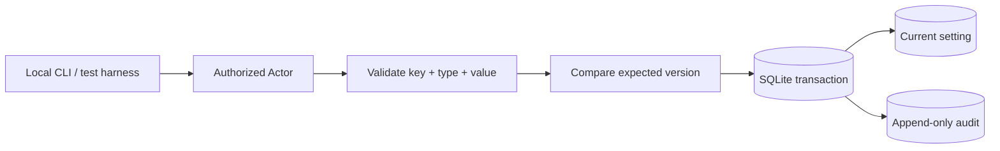

# Versioned Configuration Backend — standalone synthetic demo

> This is an **original standard-library Python demo**, not the commercial Discord configuration manager. It does not parse live JSONC files, change running bots, contact Discord or interact with real users.

## Engineering problem

A configuration change should answer four questions: **who** changed it, **what** value changed, **which version** they believed was current, and **how** to recover from a mistake. A naive overwrite of a JSON file often cannot answer these questions and is vulnerable to conflicting staff changes.

This demo stores five deliberately harmless settings in **SQLite** and exposes a small service class plus a CLI.

## Domain model



| Component | Behavior |
|---|---|
| `ConfigStore.get/list` | Read the current value and version of public demo settings |
| `update` | Require trusted staff Actor and expected version; increment only on change |
| `update_batch` | Validate all requested changes and commit as **one** SQLite transaction |
| `restore_previous` | Restore the last audited previous value and **record the restoration** |
| `history` | Show actor, change, previous/current values and timestamp |

Only a small **exact key allowlist** is editable. Key names containing credentials, webhooks or private server settings are not supported.

## Run locally

Requires Python **3.11+** and no third-party packages.

```bash
python config_demo.py --db demo-config.sqlite3 list
python config_demo.py --db demo-config.sqlite3 get support.max_open_tickets
python config_demo.py --db demo-config.sqlite3 set support.max_open_tickets 15 --version 1
python config_demo.py --db demo-config.sqlite3 history support.max_open_tickets
python config_demo.py --db demo-config.sqlite3 restore support.max_open_tickets --version 2
python -m unittest discover -s tests -v
```

String values must be supplied as **valid JSON literals**. The CLI is intended to run locally, not with untrusted remote arguments.

## Concurrent update example

Two operators read `radio.max_members` at version 1. Operator A requests value 20 and operator B requests 30, both expecting version 1.

- The first committed update creates version 2.
- The second is rejected with `VersionConflict`, rather than silently overwriting the first.
- The audit log records the successful change.
- `restore_previous` can create version 3 containing the earlier value, without destroying history.

## Failure scenarios covered by tests

- Invalid key, value type or allowed range.
- Boolean accidentally supplied where Python accepts an integer subclass.
- Unauthorized staff action from an untrusted `Actor` flag.
- Stale single-key and batch version comparisons.
- Batch validation failure without partial writes.
- Concurrent writers targeting the same version.
- Rollback with a full audit event.
- SQLite persistence after a fresh service instance.
- SQL metacharacters handled as string data.
- CLI output and documented example execution.

## Security and limitations

**Actor is a trusted local service input, not a complete authentication system.** The CLI marks its local operator as staff for demonstration; never expose it as a public API without implementing user authentication and authorization.

This demo does not read production JSONC, include Discord tokens, implement filesystem backups, distribute changes to other processes or reload production services. Its SQLite audit log is append-only through service methods, but anyone with filesystem access can still alter the database.

For a separate public HTTP demonstration with actual locally provisioned users and expiring sessions, see [Priority Access REST API](https://github.com/Scumbagsss/priority-access-bot).

**Contact:** Discord `scumbagsss` · Telegram [@dilarion](https://t.me/dilarion)
